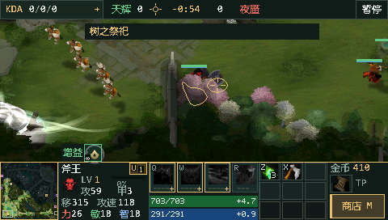
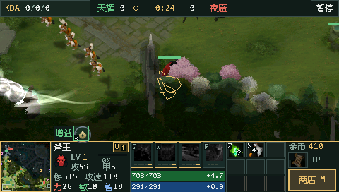
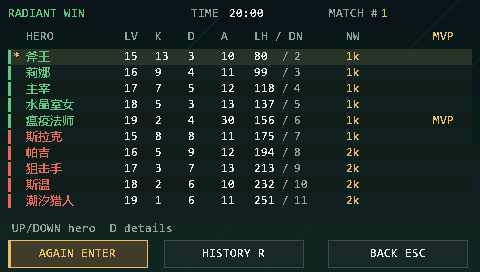
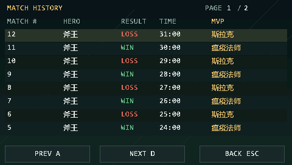

# DOTA2 · BBK H1 离线版

面向步步高 **H1 / Y100、V1.41 固件**的原生 BDA 游戏，480×272，支持实体键和触摸。采用 Dota 2 原地图、英雄模型与动作的离线预渲染图层，在 H1 上合成画面并运行独立 C 对局逻辑。当前开发版本为 **v0.30**，提供十名英雄、十人不重复英雄的离线电脑对局。

这是独立适配项目，无 Valve 官方背书。自有代码采用 GPL-2.0-or-later；Valve 素材、Microsoft 字形和 SDK 各自保留权属，见[许可与来源](#许可与来源)。仓库 `HelloClyde/BBKH1-DOTA2` 当前为私有，克隆和下载构建产物均需访问权限。

## v0.30 资源与交互更新

运行素材合并为一个 **`DOTA2.H1R`，112,861,448 字节（约107.63 MiB）**。原五个文件合计450,526,944字节，减少 **74.95%**。包内提供SCENE、SOUND、VISION和TREE四个逻辑流；重复的MAP12地图缓存不再单独存放。

这是无损资源重包：SCENE的完整虚拟字节、原偏移和全部动画帧保持一致，VISION完整数据保持一致；树层改成稀疏表示，364个有效瓦片还原的颜色、透明度、深度和归属数据逐字节相同。4,349份完全重复的帧像素负载共用存储，各自动作信息仍保留。SOUND保留为连续原始区段，音乐和音效不做二次压缩、不改变原音频数据。

新读取器按不超过16 KiB的块解码，目录按页缓存；树资源按瓦片连续分块。解码使用保留MIT许可的miniz 3.1.0。普通构建直接使用统一包，无需Steam或重新烘焙。来源、完整哈希与复现清单保存在仓库 `provenance/resource-v030/`。

传送卷轴使用独立 **G键** 和专属格，不占六格装备、三格背包或中立格。需要目标的物品先进入瞄准；450毫秒内再次按同一装备键或短点同一图标，可对合法物品施放自身，卷轴则传送至本方泉水。不能对自己使用的物品不会被强行改成自施法；合并眼仍按原同键切换类型。

已确认的合法技能或物品目标超出距离时，英雄先自动走近，进入施法范围后才扣蓝并启动冷却；目标失效或新的移动/停止等指令可取消待施法动作。

结束面板同屏展示十名英雄战绩和MVP，点击英雄行可看伤害、有效友方治疗与最终装备。主菜单 **R** 打开最近50局已完成对局，存档使用独立双槽文件，不写入素材包；失败时显示 `SAVE ERROR S`，可在结算按S重试而不重复入库。MVP为胜方优先、综合参战/助攻/伤害/建筑/友疗的本地公式，不是Valve算法。详见[对局记录与MVP](docs/MATCH-HISTORY.md)。

**v0.30第三轮C8已完成限定H1性能验收，完整新增功能覆盖仍待完成。** SD恢复后，同驱动、同实际阵容各一次约8秒短窗：新开局泉水由C7的13.47提升至C8的15.24 FPS，恢复后18.43 FPS，自然首波后中路/英雄镜头16.59 / 15.22 FPS；热窗口大体相同。资源与音频错误/欠载计数为0，正常吃树/砍树及退出资源释放通过；C8未重等自然180秒长回。这些窗口不代表全程15 FPS、后期团战或独立走路基准，详见[第三轮性能记录](docs/PERFORMANCE-v0.30-round3.md)和[设备摘要](docs/verification/v0.30-h1.json)。下方旧版记录仅作为历史结果。

## v0.29 已有功能与历史验收

战争迷雾改用固定地图坐标采样，修复镜头或英雄移动时雾边缘跳动。树木状态由每局独立位数组记录，2113棵原地图可交互树支持树之祭祀、压制之刃、狂战斧以及已接入的毁树技能；树冠、原树桩、露出的地面、寻路和视线一起更新，180秒游戏时间后重生。暂停和商店不会推进重生时间。

暂停菜单为3列×2行按钮，帮助需单独打开；“操作 / 版权介绍”两页列出键位、作者 HelloClyde、Valve原始版权及其他来源权属。帮助关闭后回到进入前的暂停或主菜单。

v0.29曾新增17,539,264字节的独立 `TREE.H1T`，与原SCENE、SOUND、MAP12和VISION共同使用。v0.30已将这些运行内容整理进统一包，安装时按下方新目录操作。

v0.29的H1正常按键/触摸已验证六按钮暂停、独立帮助与版权页、购买树之祭祀和压制之刃、树冠命中、吃树消耗和恢复、砍树冷却，以及两棵树真实180秒后重生。音乐持续推进，音频欠载为0。原脚本在程序正常退出后继续等游戏帧，原报告保留失败；同次只读补验确认正常退出、树/音频内存释放和空闲桌面。详见 [v0.29验证记录](https://github.com/HelloClyde/BBKH1-DOTA2/blob/main/docs/verification/v0.29-h1.json)。

v0.29短窗存在掉帧：砍树后约3秒为14.88 FPS，三分钟后重生约3秒为10.61 FPS；中间1秒监测窗为5.86–15.63 FPS。场景和单位活动不同，不能据此宣称v0.30造成固定幅度加速或退化，也没有全场景15 FPS保证。

## v0.28 已有功能与历史验收

v0.28加入团队战争迷雾、侦察/岗哨守卫操作、合并眼切换，以及60秒赛前倒计时和每阶段300秒的昼夜规则。功能已在v0.28 H1正常输入对局中验证，帧率仍有限制：四个短窗约为 **12.65 / 16.95 / 13.30 / 16.98 FPS**，不能概括为全场景或多数场景达到15 FPS。原自动流程的半帧计数采样失败报告完整保留，同场补读完整帧并正常退出通过，详见[v0.28验证记录](https://github.com/HelloClyde/BBKH1-DOTA2/blob/main/docs/verification/v0.28-h1.json)。

已知地图轮廓会在不可见区域暗化；实际单位可见性另按团队视野、树木与分层高地遮挡处理。这是栅格视野与整数视线近似，不运行 Valve 完整视野引擎、雾着色器或精确坡面算法。小鱼人的暗影之舞被动受敌方视野影响，主动期间仍保持强隐规则。

两处泉水、两处肉山区及地图另一处小禁区按原地图五个 `trigger_no_wards` 的凸包投影限制插眼。禁区或超出施法距离时显示红色预览；点击禁区保留瞄准，不扣守卫次数或启动冷却。原体积投影为 H1 的二维放置判定，未把泉水回血半径或地面不可行走标记当作禁插范围。

v0.28增加184,320字节的可选雾着色结果缓存，并共享完全相同遮挡参数的视野掩码；游戏视野和动态单位仍正常更新。主机逐像素比对和 MIPS 工作量检查用于验证等价性，不能换算成真机帧率承诺，详见[构建与验证](docs/BUILDING.md)。

## 快速开始

v0.30的 `main` 为未固定发布身份的开发版，尚未创建版本标签或GitHub Release。可以从仓库 [Actions](https://github.com/HelloClyde/BBKH1-DOTA2/actions) 中选择目标提交的成功构建并下载artifact；未设置发布pin时，artifact包含 `build/native/DOTA2.bda`、`build/native/DOTA2.build.json` 和 `assets/runtime/DOTA2.H1R`，供手工安装，不生成正式安装ZIP。若尚无对应成功产物，按下方步骤本地构建。源码ZIP中的Git LFS指针不能代替完整素材文件。

### 本地构建

在 Windows 上准备 Python 3.11、Git 和 Git LFS，然后执行：

```powershell
git lfs install
git clone --recurse-submodules https://github.com/HelloClyde/BBKH1-DOTA2.git
cd BBKH1-DOTA2
git lfs pull
python -m pip install -r tools/requirements-build.txt
python tools/install_toolchain.py
python tools/build.py --toolchain .tools/toolchain/bin --output build/native
python tools/verify.py --build build/native
```

已有 GNU MIPS 15.2.0 工具链时，可跳过安装器，把 `--toolchain` 换成它的 `bin` 目录；也支持 `H1_GNU_BIN`。构建与打包会保留已有输出目录，再次执行时请选择新的输出目录。当前未pin的开发版可直接构建和校验；`tools/package.py` 只为已固定完整BDA SHA的发布候选封包，普通开发构建无需执行它。构建使用已提交的图标、字形和素材包，无需安装 Steam 或重新烘焙资源。更多说明见[构建与验证](docs/BUILDING.md)。

### 安装到 H1

使用开发artifact或本地构建时，手工复制以下两个文件：

| 电脑上的文件 | 设备路径 |
| --- | --- |
| `build/native/DOTA2.bda` | `A:\应用\程序\DOTA2.bda` |
| `assets/runtime/DOTA2.H1R` | `B:\DOTA2\DOTA2.H1R` |

v0.30需要配套的新BDA和 **112,861,448字节 `DOTA2.H1R`**，不要只更新程序。当前C8沿用同一统一包；设备已有相同SHA的完整文件时无需重传。统一包SHA-256为 `00ecddaf28bb3716cf9042115498b81e2b01363e66baa3e03b03b914be466153`，程序身份见对应 `DOTA2.build.json`。运行时不再逐个读取旧SCENE、SOUND、MAP12、VISION、TREE文件，也不要求 `SCENE.json`。

资源包缺失或无效时补齐匹配文件，安全弹出磁盘，刷新H1桌面后打开 **DOTA2**。将来使用已pin并封装的安装ZIP时，分别将其中 `应用/程序/DOTA2.bda` 和 `DOTA2/DOTA2.H1R` 复制到上述路径，并按 `SHA256SUMS.txt` 校验。设备运行时不需要Python、Steam或H1Debug。

战绩优先保存到 `B:\DOTA2\MATCH0.H1S` / `MATCH1.H1S`，备用为 `A:\DOTA2.HS0` / `DOTA2.HS1`。更新程序和素材时保留这些存档。只有完成的对局入库，退出未结束的对局不生成胜负记录。

选人后按Enter开始；方向键或轻点地面移动，Q/W/E/R施放主动技能，Z/X/C/V/B/N使用六格主动装备，**G使用独立卷轴**。需要目标的技能先进入瞄准，再点单位或地面；Esc取消。点按或拖动小地图切换视野，SPACE或点击英雄状态栏回中。**BACK在游戏中暂停，暂停页X才退出**。M打开商店并暂停对局；商店内T看英雄推荐、G看升级去向、Enter下单。在暂停菜单选“帮助H”查看键位，也见[操作说明](docs/CONTROLS.md)。

## 截图

前两张为 **C8真实H1的480×272截图**，来自正常输入树操作验收：统一资源包运行画面与完成吃树、砍树后的画面。它们绑定已验收C8的BDA、ELF、构建记录及原始采集报告，不用于推算FPS。





以下为实际C界面在主机上的测试截图，使用构造的完成对局数据检查十人结算、MVP和历史翻页；不是已玩过的H1对局或用户战绩。





所有图像均按480×272保存，来源、SHA-256和采集类别见[截图清单](docs/screenshots/manifest.json)。Host预览不属于H1功能或FPS验收，旧版图像保留各自版本身份。

## 当前内容

- 斧王、莉娜、主宰、水晶室女、斯拉克、瘟疫法师、帕吉、狙击手、斯温、潮汐猎人；快速模式经验与金币、手动加点、先天与天赋。
- 原地图的动态河水、泉水动画、建筑与树木，英雄和单位的预渲染动作、阴影、攻击弹道、技能表现；野区、远古野怪、肉山及洞内外视野隔离。
- 六格装备、三格背包、中立槽、全图购买与自动信使；装备目录、真实配方升级列表和按英雄分阶段推荐。商店关闭后恢复进入前的暂停状态。
- 独立G键传送卷轴、合法物品双击自施法/卷轴回泉；有效目标超出距离时自动走近再施放。
- 十人结算战绩、英雄详情、本地贡献MVP及最近50局完成对局的双槽持久历史。
- 魔晶按十位英雄各自机制接入；实际获得额外能力时，技能行在相同宽度内从四格切为五格，新增主动使用 T。屠夫喷吐只在吞下友军期间出现。
- 团队战争迷雾与树木/高地的栅格遮挡；商店 L 快速选择两类眼，合并眼瞄准中再按同装备键切换类型；五处原地图禁区显示红色预览，合法放置成功后才消耗。
- 60秒赛前倒计时，号角后开始比赛计时；昼与夜每阶段300秒。
- 原音乐与音效；动态缓存及带自检/回退的精确 RGB565 MXU 转换。MXU 就绪时节省 256 KiB 转色表，未宣称整局按固定比例提速。

这是十英雄的离线适配，尚无多人联网。地图相机固定角度，不能旋转或缩放。2113棵源地图可交互树有独立状态；源场景中未对应可交互实体的装饰树保持常景。四棵原cine树未带树桩模型，砍掉后直接露出地面；其余使用对应原树桩。地图轮廓在无视野处暗化，树木和高地遮挡采用格网与高度分层近似，未实现Valve完整视野引擎。部分技能、装备和设施边界仍有简化，目录齐全不代表所有原版交互完全等价。

## 依赖

| 用途 | 依赖 |
| --- | --- |
| 运行成品 | BBK H1 / Y100 V1.41；A 盘程序与 B 盘运行素材 |
| SDK | [MrDefinition1999/bbk-h1-bda-sdk](https://github.com/MrDefinition1999/bbk-h1-bda-sdk)，`sdk/` 子模块固定到 `067fe072477861dfc8949d7b1a55279fb92d2548`，Apache-2.0 |
| 无损块解码 | miniz 3.1.0的低层tinfl，MIT；上游与适配记录见 `third_party/miniz/UPSTREAM.json` |
| 构建 | Python 3.11（本地验证 3.11.5）、GNU MIPS GCC 15.2.0、Git LFS；Pillow 12.3.0、pyelftools 0.33 由依赖文件固定 |
| 历史素材生成 | 本机 Steam Dota 2、Source 2 Viewer / ValveResourceFormat 20.1，以及离线烘焙工具；普通构建不运行这些流程 |

源码仓库包含必要生成文件；`private/generated/` 是沿用的代码引用目录名，其中的必要文件受版本管理。基础UI当前676字形，旧672条记录不变，仅增加本轮历史/操作所需4字。Windows原字体文件没有随库复制。字形来源及授权缺项见[字体说明](licenses/FONT-NOTICE.md)。

## 验证记录

v0.30已完成统一资源包的离线全逻辑流校验，以及C8正常加载、11个约8秒FPS窗口、暂停恢复、镜头、音频、正常树操作和退出/释放的限定H1验收；完整新增功能覆盖仍未完成。SD恢复后的C7/C8同驱动、同实际阵容结果见[第三轮性能记录](docs/PERFORMANCE-v0.30-round3.md)，完整历史见[本版性能记录](docs/PERFORMANCE-v0.30.md)。验收绑定记录中的确切BDA/ELF，后续main提交以各自构建身份和检查结果追踪，不自动继承真机结论。以下均为旧版本独立记录。

v0.28 的最终 BDA 已通过两组实际 MIPS 窄回归，并在 H1 上用正常按键/触摸验证暂停冻结、购买合并眼、泉水禁插不扣次数、走到合法位置放置两类实体眼、自然号角 tick1201出兵及战争迷雾。原自动报告25项检查中的24项通过，最后一项读到了渲染半帧计数；原报告仍为失败，未改写。随后在同一局补读到完整帧并正常 BACK/X 退出，资源释放、设备空闲，补充报告通过。记录明确区分 `functional_passed=true`、`automated_run_passed=false` 和 `continuation_passed=true`。

历史v0.28完成帧计数的四个约6秒窗口为：

| 场景 | 平均 FPS |
| --- | ---: |
| 开局短窗 | 12.65 |
| 移出泉水禁区、已放置两类眼 | 16.95 |
| 自然出兵后 | 13.30 |
| 镜头移向中路的迷雾区域 | 16.98 |

各窗口音频欠载新增为0。这里没有完整对局、固定完整阵容对照或逐秒下限保证，不能宣称全场景或多数场景达到15 FPS；缓存的指令工作量下降也不能替代这些实测值。旧版确切BDA、ELF、159项输入身份、原失败报告与同场补充报告见[v0.28验证记录](https://github.com/HelloClyde/BBKH1-DOTA2/blob/main/docs/verification/v0.28-h1.json)。

原开发环境的 v0.27 已做 H1 真机按键、镜头、暂停、商店购买与信使配送、正常退出验证。一次配对短测中，开局站立、斜向走位、后续站立三段平均为 **17.74 / 18.74 / 19.53 FPS**，各测量窗口音频欠载新增为 0。随机种子及完整阵容未固定，这些结果不证明改动造成提速，也不保证整局或每秒均达到该帧率。

精简记录及原报告SHA-256见[历史v0.27真机记录](https://github.com/HelloClyde/BBKH1-DOTA2/blob/main/docs/verification/v0.27-h1.json)。这份记录只对应旧版确切BDA与三个原运行包，不能直接用于v0.30；本地编译或CI成功本身不等于新增真机/模拟器验证。

## 许可与来源

本项目自有代码与MXU适配代码采用 **GPL-2.0-or-later**，完整文本见 [LICENSE](LICENSE) 和 [licenses/GPL-2.0.txt](licenses/GPL-2.0.txt)。SDK保持其Apache-2.0许可；miniz低层解码器保持MIT许可，见 [third_party/miniz/LICENSE](third_party/miniz/LICENSE)。

Dota 2 的图标、模型、地图、动画、音乐、音效及其转换结果仍属 Valve；生成的 Microsoft YaHei / Consolas 位图字形不适用项目 GPL，项目未另获这些字形子集的再分发授权。仓库私有状态不改变第三方权利。详细边界及来源见 [NOTICE.md](NOTICE.md)、[assets/NOTICE.md](assets/NOTICE.md) 和[字体来源记录](docs/provenance/fonts.json)。

## 感谢

感谢持续提供玩法反馈、连接 H1 并协助真机测试的用户；感谢 Valve 的 Dota 2 原始作品、[BBK H1 Native BDA SDK](https://github.com/MrDefinition1999/bbk-h1-bda-sdk) 的 H1 接口与打包支持，以及 [Source 2 Viewer / ValveResourceFormat](https://github.com/ValveResourceFormat/ValveResourceFormat) 的格式解析与导出工具。精确转色内核保留同工作区 `h1-arcade/src/mxu.S` 的 GPL 来源说明，指令编码参考 Ingenic XBurst MXU ISA 手册。致谢不替代各自许可证。
