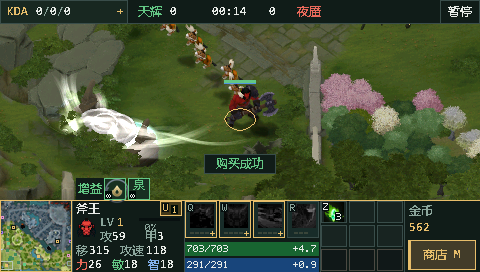
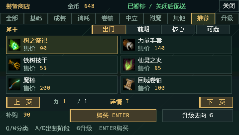
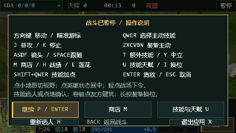
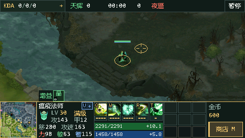

# DOTA2 · BBK H1 离线版

面向步步高 **H1 / Y100、V1.41 固件**的原生 BDA 游戏，480×272，支持实体键和触摸。采用 Dota 2 原地图、英雄模型与动作的离线预渲染图层，在 H1 上合成画面并运行独立 C 对局逻辑。当前版本为 **v0.27**，提供十名英雄、十人不重复英雄的离线电脑对局。

这是独立适配项目，无 Valve 官方背书。自有代码采用 GPL-2.0-or-later；Valve 素材、Microsoft 字形和 SDK 各自保留权属，见[许可与来源](#许可与来源)。仓库 `HelloClyde/BBKH1-DOTA2` 当前为私有，克隆和下载构建产物均需访问权限。

## 快速开始

本轮未创建版本标签或 GitHub Release。可以从仓库 [Actions](https://github.com/HelloClyde/BBKH1-DOTA2/actions) 的成功构建中下载 artifact；若尚无成功产物，按下方步骤本地构建。不要将 GitHub 的源码 ZIP 当作安装包：三大运行素材由 Git LFS 保存。

### 本地构建

在 Windows 上准备 Python 3.11、Git 和 Git LFS，然后执行：

```powershell
git lfs install
git clone --recurse-submodules https://github.com/HelloClyde/BBKH1-DOTA2.git
cd BBKH1-DOTA2
git lfs pull
python -m pip install -r tools/requirements-build.txt
python tools/install_toolchain.py
python tools/build.py --toolchain .tools/toolchain/bin --output build/native
python tools/verify.py --build build/native
python tools/package.py --build build/native --output dist
```

已有 GNU MIPS 15.2.0 工具链时，可跳过安装器，把 `--toolchain` 换成它的 `bin` 目录；也支持 `H1_GNU_BIN`。构建与打包会保留已有输出目录，再次执行时请选择新的输出目录。构建使用已提交的图标、字形和素材包，无需安装 Steam 或重新烘焙资源。更多说明见[构建与验证](docs/BUILDING.md)。

### 安装到 H1

解压生成的 `dist/DOTA2-H1-install.zip`，将两个目录分别复制到设备：

| 安装包内容 | 设备路径 |
| --- | --- |
| `应用/程序/DOTA2.bda` | `A:\应用\程序\DOTA2.bda` |
| `DOTA2/` 素材目录 | `B:\DOTA2\` |

素材共 **432,848,352 字节，约 413 MiB**。B 盘目录中保留 `SCENE.H1P`、`SOUND.H1A`、`MAP12.H1C` 与 `SCENE.json`，不要只复制 BDA。安全弹出磁盘，刷新 H1 桌面后打开 **DOTA2**。程序与素材校验值见安装包的 `SHA256SUMS.txt`。设备运行时不需要 Python、Steam 或 H1Debug。

选人后按 Enter 开始；方向键或轻点地面移动，Q/W/E/R 施放主动技能，Z/X/C/V/B/N 使用主动装备。需要目标的技能先进入瞄准，再点单位或地面；Esc 取消。点按或拖动小地图切换视野，SPACE 或点击英雄状态栏回中。**BACK 在游戏中暂停，暂停页 X 才退出**。M 打开商店并暂停对局；T 看本英雄推荐，G 看所选装备的升级去向，Enter 下单。完整键位随暂停菜单显示，也见[操作说明](docs/CONTROLS.md)。

## 截图

以下三张为 v0.27 **物理 H1 屏幕抓取**，原始分辨率 480×272，未重绘。



| H1 真机：英雄推荐商店 | H1 真机：暂停与按键帮助 |
| --- | --- |
|  |  |

下面是 **PC 主机上实际 C 渲染器的预览**，用于核对 NEC 获得魔晶后的五技能布局，不能作为真机帧率或技能效果验收依据。



截图原文件身份与采集类别见[截图清单](docs/screenshots/manifest.json)。

## 当前内容

- 斧王、莉娜、主宰、水晶室女、斯拉克、瘟疫法师、帕吉、狙击手、斯温、潮汐猎人；快速模式经验与金币、手动加点、先天与天赋。
- 原地图的动态河水、泉水动画、建筑与树木，英雄和单位的预渲染动作、阴影、攻击弹道、技能表现；野区、远古野怪、肉山及洞内外视野隔离。
- 六格装备、三格背包、中立槽、全图购买与自动信使；装备目录、真实配方升级列表和按英雄分阶段推荐。商店关闭后恢复进入前的暂停状态。
- 魔晶按十位英雄各自机制接入；实际获得额外能力时，技能行在相同宽度内从四格切为五格，新增主动使用 T。屠夫喷吐只在吞下友军期间出现。
- 原音乐与音效；动态缓存及带自检/回退的精确 RGB565 MXU 转换。MXU 就绪时节省 256 KiB 转色表，未宣称整局按固定比例提速。

这是十英雄的离线适配，尚无多人联网。地图相机固定角度，不能旋转或缩放；原树木不能动态砍除或再生，地形底图常亮，未实现完整的原版高地/树林战争迷雾。部分技能、装备和设施边界仍有简化，目录齐全不代表所有原版交互完全等价。

## 依赖

| 用途 | 依赖 |
| --- | --- |
| 运行成品 | BBK H1 / Y100 V1.41；A 盘程序与 B 盘运行素材 |
| SDK | [MrDefinition1999/bbk-h1-bda-sdk](https://github.com/MrDefinition1999/bbk-h1-bda-sdk)，`sdk/` 子模块固定到 `067fe072477861dfc8949d7b1a55279fb92d2548`，Apache-2.0 |
| 构建 | Python 3.11（本地验证 3.11.5）、GNU MIPS GCC 15.2.0、Git LFS；Pillow 12.3.0、pyelftools 0.33 由依赖文件固定 |
| 历史素材生成 | 本机 Steam Dota 2、Source 2 Viewer / ValveResourceFormat 20.1，以及离线烘焙工具；普通构建不运行这些流程 |

源码仓库包含必要生成文件；`private/generated/` 是沿用的代码引用目录名，其中的必要文件受版本管理。Windows 原字体文件没有随库复制。字形来源及授权缺项见[字体说明](licenses/FONT-NOTICE.md)。

## 验证记录

原开发环境的 v0.27 已做 H1 真机按键、镜头、暂停、商店购买与信使配送、正常退出验证。一次配对短测中，开局站立、斜向走位、后续站立三段平均为 **17.74 / 18.74 / 19.53 FPS**，各测量窗口音频欠载新增为 0。随机种子及完整阵容未固定，这些结果不证明改动造成提速，也不保证整局或每秒均达到该帧率。

精简记录及原报告 SHA-256 见[真机验证记录](docs/verification/v0.27-h1.json)。只有新构建的 BDA 与该记录及运行素材身份一致时，才能复用这份历史证据；本地编译或 CI 成功本身不等于新增真机/模拟器验证。

## 许可与来源

本项目自有代码与 MXU 适配代码采用 **GPL-2.0-or-later**，完整文本见 [LICENSE](LICENSE) 和 [licenses/GPL-2.0.txt](licenses/GPL-2.0.txt)。SDK 保持其 Apache-2.0 许可。

Dota 2 的图标、模型、地图、动画、音乐、音效及其转换结果仍属 Valve；生成的 Microsoft YaHei / Consolas 位图字形不适用项目 GPL，项目未另获这些字形子集的再分发授权。仓库私有状态不改变第三方权利。详细边界及来源见 [NOTICE.md](NOTICE.md)、[assets/NOTICE.md](assets/NOTICE.md) 和[字体来源记录](docs/provenance/fonts.json)。

## 感谢

感谢持续提供玩法反馈、连接 H1 并协助真机测试的用户；感谢 Valve 的 Dota 2 原始作品、[BBK H1 Native BDA SDK](https://github.com/MrDefinition1999/bbk-h1-bda-sdk) 的 H1 接口与打包支持，以及 [Source 2 Viewer / ValveResourceFormat](https://github.com/ValveResourceFormat/ValveResourceFormat) 的格式解析与导出工具。精确转色内核保留同工作区 `h1-arcade/src/mxu.S` 的 GPL 来源说明，指令编码参考 Ingenic XBurst MXU ISA 手册。致谢不替代各自许可证。
