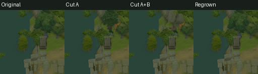

# v0.29 自然树视觉资源来源

## 为什么最终包仍有17.5MB

只读占用分析见 `size-study.json` 与 `size-study-supplement.json`。2113个可交互实例来自13个原模型，但有36个模型/skin组合、12种tint、5种scale、183组原角度；当前逐实例SS2烘焙又保留子像素相位。树体裁剪图有2108份完全不同的像素结果。当前包没有装13份原3D模型，它将这些实例展开成364个瓦片、1400个按像素深度排序的树体、树桩和常景层。

最终包的实际分摊：地面RGB约2.40MB、地面深度1.53MB，owner约3.04MB，树层RGB4.61MB、树层深度3.70MB、alpha2.22MB；其余为文件头、目录和对齐。现有零RLE的控制字节本身约6.38MB，已计入上述各项。按瓦片展开与简单压缩均有明显开销。

临时无损压缩实验估算：相同逐tile数据改用DEFLATE level6约10.72MB；这需要新增有界解码器及H1验证，当前程序未支持该实验格式，设备仍安装已验收的17,539,264字节包。独立裁剪实例帧加地面补丁、沿用RLE约13.62MB，也需重组provider。共享树种/朝向图集可继续减少实例数据，但需要重新处理原角度、尺度、颜色与像素相位，地面补洞约3.9MB仍须保留。这些是离线尺寸分析，未修改现有运行包或冒称已部署。

这里保存离线资源准备与主机参考验证的清单，不代表 H1 运行时、MIPS provider 或真机功能已经通过。没有复制原模型、纹理、4226 个 NPZ 帧或整个背景图；运行文件的完整 SHA 记录在清单中。Valve 原素材及转换结果仍保留原权属，不由项目 GPL 重新授权。

## ID 与常景

可交互树严格采用 `provenance/vision/trees.json` 的2113条原顺序，以 Hammer ID 匹配原2475个活跃树实体；不重新按坐标排序。每个 ID 分别烘焙原树体和原 stump 网格，使用实体原矩阵、颜色、材质组和2倍采样，保存原生像素 RGBA/最近深度。

其余362个自然树实体作为常景，不接受 cut 状态。另有2417个 `agg_prop_tree_*` worldnode 绘制片：17个 gnarly、1305个 leaves05、1087个 leaves08、8个 blank。它们没有与自然树完全相同的实体矩阵，位置与旋转也不支持按最近距离猜测归属，因此本版将它们作为独立常景保留；这不是对原引擎所有隐式关联规则的逆向结论。常景先合成到一个 RGBA/深度层，token 为 `0x7fff`，不会因邻树被砍而关闭。

`tree_cine_02_low` 共8个，4个位于可交互 ID 集合中，4个属于常景。可交互的 ID 为359/453/566/963，Hammer ID 分别为92911/94811/97020/104084。原模型导出只有树体和 inspector，没有 stump 网格；这4个 dead 帧透明，并明确记录在 `original_stump_mesh_absent_ids`，没有套用其他树种的树桩，也不声称已恢复原引擎可能的替代规则。

`model-sources.json` 和 `model-provenance/` 保存17个 glTF 的 SHA、buffer SHA、原 compiled VPK 条目 CRC/SHA 和导出身份；`material-receipts.json` 保存原材质组和实际用到的资源身份。JSON 以相同值规范成 LF，原始字节哈希与仓库字节哈希分开记录于 `copy-receipts.json`。不把换行转换后的字节冒称原始来源字节。

## 背景与遮挡

无树背景保持3840×2816、origin[-512,-512]、zoom180、pitch181。它使用原138份地形、原水面与全部非树静态设施，补入303个桥墙、楼梯、灯、祭坛、传送门和池体实例；动态 filler 和莲花果实另行绘制。原地面高度网格与现版逐字节相同，泉水光照按现版已审参数在新地面上重新求值。

包的 base 不是无条件替换原图。先求最近的可交互活树深度：只有它与原 map-lit 深度相差不超过1，且确实在无树静态背景与常景前方，才采用无树 RGB/深度；其他像素保留原 map-lit RGB/深度。每个候选层还须在 base 和静态深度前方，避免移除树时擦掉建筑或前景。精确条件见 `base-rule.json`。

运行时约定为：没有 cut 时直接使用原图；变化瓦片内，若原最近活树或常景未受 cut 影响，也保留原像素。只有原最近树被砍或新 stump 出现在前方时才合成。这里的主机参考程序按该约定验证，实际平台实现仍需独立验收。

## TREE.H1T 格式

128字节、32个 little-endian u32 头，绑定原 `SCENE.H1P` SHA。xy 表按原2113 ID顺序保存世界坐标 `(q8+128)>>8`；bbox 是 map-local 像素半开区间 `[minx,miny,maxx,maxy]`，含树体和存在的 stump 并集。

660个128×128瓦片，每个目录项24字节，分别记录 offset、storedBytes、decodedBytes、canonical decoded CRC、codec 和 coveragePixels。空项全0。decoded tile 是16字节头、RGB565/depth两块 base plane，以及每层 owner/RGB565/depth/alpha（每像素7字节）。层按深度近到远排列；透明空项 owner=`0xffff`，活树 token=`id`，stump token=`0x8000|id`，常景=`0x7fff`。

codec1 对每个 u16 plane 独立做与 map codec 相同的 delta、zigzag、低/高字节转置，再使用实际 `cache_rle.h`；tile头和alpha保持原样。codec0直接存 canonical 原始数据。CRC 针对 inverse 之后的 canonical 字节；tables CRC 覆盖 xy+bbox+dir，header CRC 把 word31置0后计算。

本包23,621,716字节，364个非空瓦片，实际最多8层、maxDecoded983056、maxStored214803。**8是统计结果，不是裁层上限**；所有原有重叠层均保留。完整文件 SHA 为 `81cc4839bc016445a36cd5157e978189d11fea8c1ada2386e7c16d3a5f3b8f47`。

## 主机 QA 与预览

`qa-verification.json` 由独立 Python RLE/inverse 读取实际文件，验证 header/tables CRC、2113 ID/xy/bbox、364个非空瓦片的 canonical CRC、深度排序和 token。

重叠样例为 tile527、树242/264（Hammer91009/91369），有670个不透明重叠像素。测试未砍、砍A、砍A+B、复生四态：依次露出242、264、背景，复生 RGB/深度与原图相同。四态各保护13759个源静态像素，共55036次像素比较；不是55036个独立像素。另一测试砍1879后露出常景 token0x7fff，常景不随 cut 消失。



此图为主机资源参考合成，不是真机截图，不证明平台 provider 或设备帧率。原始 QA 源码快照在 `source-data/qa_pack.py`，字节身份与原执行脚本相同。

## 可复跑入口

普通 BDA/CI 构建不运行这些资源工具。资源重建需要本机历史 Source2 导出工作区、NumPy、Pillow、MSYS2 GCC，以及共同父目录中的 Source2 Viewer20.1；不会从网络补齐缺失的大型原资源。源工作区只读，所有缓存、DLL和输出写入新仓库 build 下，已有输出目录会拒绝覆盖。

```powershell
python -B tools/bake_tree_background.py --source-root PATH/TO/h1-dota2 --output build/tree-rebake/no-trees
python -B tools/bake_tree_layers.py --source-root PATH/TO/h1-dota2 --frames build/tree-rebake/frames --background build/tree-rebake/no-trees --output build/tree-rebake/pack
```

`frame-manifest.json`、`background-manifest.json`、`association-audit.json`、`pack-manifest.json` 保留各阶段输出与生成器 SHA。运行时平台代码、动态 cut 状态、设备安装和真机验收由其他独立报告覆盖；本目录不将它们标成通过。


## 当前默认包：稀疏 base（补充记录）

前文23,621,716字节及旧生成器 SHA 描述初版全 base 包，原始 README 与 READY 已逐字节保存在 `README-full-base-original.md` / `READY-full-base-original.json`，旧清单和历史源 SHA 没有改写。当前默认生成器对每个瓦片计算所有层 alpha 的并集，只把并集外的两个 base plane 置0；这些像素没有任何有效层，在运行时 patch/pick 合同下不会读取 base。没有改动任何 owner、树 RGB、树深度、alpha、有效 base 像素或层数。

当前包17,539,264字节，SHA `cb665855d9b4d8c20f2e0603492ed4425cb11a2c3763f51eadf30c5d9162aa80`，364个非空瓦片、maxLayers8、maxDecoded983056、maxStored210843。相较初版减少6,082,452字节（25.75%）；没有引入另一种 codec。

`sparse-active-pixel-equivalence.json` 逐瓦片验证全部1400个层记录字节不变、1,073,295个有效像素的 base 两 plane 不变，只有4,890,481个无 alpha 像素的 base 清零。所有 header、tables 和 canonical tile CRC 重新通过。由于任何 cut/复生状态只能选择现存层，这一并集外不会产生新有效像素；等价结论以运行时始终跳过无层像素为前提。

`sparse-qa-verification.json` 对同一树/邻树双砍/复生和常景样例再次验证，四态 RGB/深度 hash 与初版相同，主机预览 PNG 的 SHA 也相同。它仍不是平台或 H1 验收。

新工具的 `--full-base` 模式另生成完整文件并与旧包逐字节相同，见 `sparse-full-base-reproduction.json`。旧 producer 从 Git index 的改动前字节保存于 `source-data/bake_tree_layers-full-base-original.py`，SHA 与旧 frame/pack manifest 的 generator SHA 一致；新 producer 的 SHA 独立记录在 READY 的 `current_sparse`，不替换旧源身份。旧的可复跑命令现在默认输出稀疏包，需要初版行为时加 `--full-base`。
